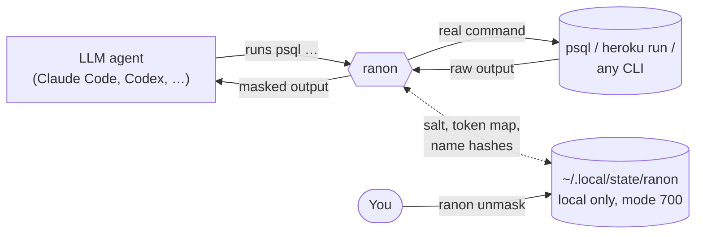
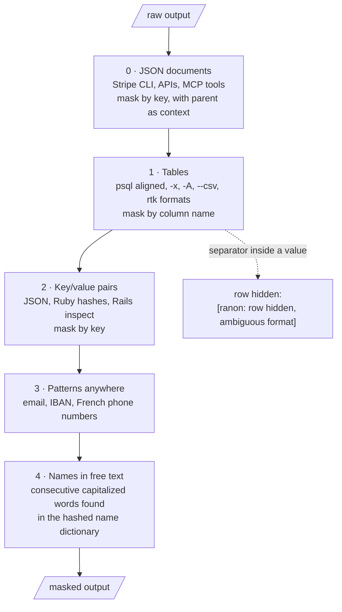
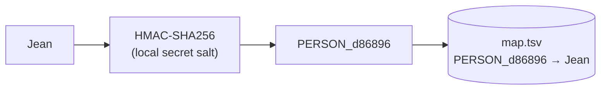

# ranon

[](https://github.com/ludovicl/ranon/actions/workflows/ci.yml)

**Masks personal data in command output before it reaches an LLM agent.**

Coding agents are most useful when they can query real systems: a read replica, a production console, an API. That output often holds names, emails, IBANs or addresses that should not leave your machine. ranon sits between the command and the agent and replaces each sensitive value with a stable pseudonym:

```text
 id |  first_name   |   last_name   |     email     | organisation_name
----+---------------+---------------+---------------+-------------------
 42 | PERSON_d86896 | PERSON_55fc2c | EMAIL_d2f401  | ORG_87d061
```

Same value, same token: the model can still join, count and compare. The token → value map stays on your machine, so you can turn the model's answer back into real values.

Inspired by [rtk](https://github.com/rtk-ai/rtk): one small binary that works as a command proxy, an agent hook or a stdin filter.

## How it works



ranon plugs in at one of three places:

| Mode | How | Covers |
|---|---|---|
| **Agent hook** | `ranon hook claude` as a Claude Code `PostToolUse` hook | Bash output of `psql`, `heroku run`, `stripe` (and any command you add), plus any MCP tool you match |
| **PATH shim** | `ranon init` creates `psql → ranon`; put that directory first in the agent's PATH | Any agent harness, including output redirected to a file |
| **Filter** | `ranon psql …`, `… \| ranon mask` | Manual use and scripts |

### The masking pipeline

Every output goes through five passes, from the most structured to the least:



0. **JSON documents by key path.** Wherever a line starts a JSON document (the whole output, JSON lines, JSON after a banner) or ends by opening one (`#<Treezor::User id=1> JSON: {`), each key is checked alone and as `parent.key`, where the parent is the object's `"object"` field (Stripe, Notion) or the enclosing key. So a Stripe `customer.name` or `billing_details.name` is masked while a product `name` stays readable, and everything under a sensitive key (`address`, `dob`) is masked.
1. **Tables by column name.** Sensitive columns: first/last/full names, email, phone, IBAN, birth date and place, address, nationality, social security or tax number, payer/payee names (creditor, debtor, recipient, customer…), organisation name, IP addresses, passwords and tokens ([`src/rules/builtin.rs`](src/rules/builtin.rs)). Names are matched as written and in snake_case, so `dateOfBirth` and `Last Name` are covered like `date_of_birth` and `last_name`. Other columns (`id`, `status`, `amount`, `country`, …) stay readable, and so do identifiers, timestamps and flags about a personal field (`address_id`, `phone_verified_at`). A row whose separator count does not match the header is hidden rather than guessed.
2. **Key/value pairs by key**: `first_name: "Jean"`, `"email": "…"`, `"last_name"=>"…"`, JSON inside a CSV cell, and YAML-like lines (`last_name: Dupont`).
3. **Value patterns anywhere**: email, IBAN (known country code and plausible length), French phone numbers, IPv4 addresses.
4. **Full names in free text**: two or more consecutive capitalized words found in the name dictionary (`Jean Dupont`, `DUPONT Marie-Anne`), or one after a title (`M. Dupont`, `Mme Petit`). A lone dictionary word is left alone, because real databases contain junk "names" such as *Bonjour* or *Paris*.

`psql -t` / `--tuples-only` output is hidden: without a header there is no column name to mask by.

### How names are recognized

A name is masked in one of two ways, depending on where it shows up.

**In a named field** (a column, a JSON key, a key/value pair), ranon looks at the name of the field, never at the value. `first_name`, `lastName`, `Nom` or `real_name` match a `PERSON` rule, so the whole value is replaced, whatever it is. A lone first name or a surname nobody has seen before is masked like any other.

**In free text** (a chat message, a ticket body, a comment) there is no field name, so ranon uses a dictionary built from your own data:

1. `ranon dict build` reads the first and last names of your users table. Each word is lowercased, stripped of its accents and hashed with the local salt; only the hash is written to `names.bin`. The names are never printed, so the agent that runs the command does not see them.
2. For each capitalized word of the text, ranon computes the same hash and looks it up.
3. A word found in the dictionary is masked only next to another dictionary word (`Jean Dupont`, `DUPONT Marie-Anne`) or after a title (`M. Dupont`).

The dictionary does not try to know every surname in the world, only the names of the people whose data can come out of your systems. The list is as long as your users table, and a rare surname is in it as soon as one user bears it.

What follows from this design:

- Someone outside the source table (a colleague, a contact at a supplier) is not recognized in free text, unless a user shares the name.
- A lone first name or surname, and a name written in lowercase, stay readable in free text.
- The dictionary is a snapshot. A user created after the last `ranon dict build` with a name nobody else has is missing until you rebuild it; schedule the command (weekly is enough) if your data moves.
- In free text every word gets its own token (`PERSON_aaaaaa PERSON_bbbbbb`), while a `full_name` column gets one token for the whole value: the same person can bear both.
- `names.bin` cannot be read back into names. With the salt, though, one can test whether a given name is in it: one more reason never to share the state directory.

### Tokens



- Tokens are `KIND_` plus the first 6 hex characters of an HMAC with a 32-byte random salt created on first run. Without the salt, a token cannot be reversed or brute-forced from a list of common names.
- Two values that would fall on the same token get different ones: the second is rehashed, so unmasking never returns someone else's value.
- Spellings of the same email (case) or IBAN (spaces) share one token.
- Masking is idempotent: a token is never masked twice.
- The name dictionary stores salted 64-bit hashes only, never the names.

## Rules

Built-in rules are grouped by source in [`src/rules/builtin.rs`](src/rules/builtin.rs):

| Set | Covers |
|---|---|
| `common` | names, email, phone, birth date and place, address, nationality, social security and tax numbers, organisation names |
| `payments` | IBAN, creditor/debtor/recipient/cardholder names, card embossed names, Stripe `customer`, `billing_details`, `shipping`, `individual`; command `stripe` |
| `collaboration` | `user.name` in Notion and GitHub user objects, Slack `real_name`, `display_name`, `userName` |
| `security` | IP addresses, passwords, API keys and tokens |
| `databases` | commands `psql`, `heroku run` |

### Your own rules

Add yours in `~/.config/ranon/` (or `$XDG_CONFIG_HOME/ranon`, or `$RANON_CONFIG_DIR`), no rebuild needed: `rules.toml`, and any number of `rules.d/*.toml`, e.g. one file per source:

```text
~/.config/ranon/rules.d/
├── notion.toml     # property names of your workspace
├── treezor.toml    # fields of your banking provider
└── gmail.toml      # commands = ["composio"]
```

Each file can hold four kinds of entries:

```toml
# column or key names → kind; user rules are checked before the built-in ones
[[column]]
pattern = '^(nom|prénom)$'
kind = "PERSON"

[[column]]
pattern = '(^|\.)beneficiaries\.name$'      # JSON: "name" inside a "beneficiaries" list
kind = "PERSON"

# values anywhere in the text
[[value]]
pattern = '\b\d{14}\b'
kind = "SIRET"

# keep these visible even if a built-in rule matches
keep = ['^email_id$']

# extra shell commands masked by the Claude Code hook
commands = ["composio"]
```

Patterns are [Rust regexes](https://docs.rs/regex) matched on the lowercased name and on its snake_case form; kinds are uppercase letters. The first match wins, in this order: your `keep`, your `[[column]]` rules, the built-in keeps, the built-in columns. `ranon rules` lists every source, and tells which rule applies to a name and where it comes from:

```text
$ ranon rules Prénom creditor_name status
user file: ~/.config/ranon/rules.d/notion.toml
  notion.toml: 4 column rules
  built-in payments: 4 column rules, commands: stripe
  …
Prénom: PERSON (notion.toml)
creditor_name: PERSON (built-in payments)
status: kept visible
```

An invalid file is an error, never a silent fallback: the hook then hides the output.

## Install

Requires Rust 1.88+ on Linux or macOS.

```sh
cargo install --git https://github.com/ludovicl/ranon
```

The sections below describe each step. To have your agent do them, see [Let your agent set it up](#let-your-agent-set-it-up).

### Name dictionary (optional, for pass 4)

```sh
export DATABASE_URL=postgres://readonly@replica/app
ranon dict build --sql "select first_name from users union select last_name from users"
# or from any source, one or more names per line:
cut -d, -f2,3 people.csv | ranon dict build --stdin
ranon dict stats
```

Names go straight from `psql` into the hasher; they are never printed. `--db-url-env` reads the URL from another variable, `--replace` starts from an empty dictionary.

### Claude Code hook

In `.claude/settings.json`:

```json
{
  "hooks": {
    "PostToolUse": [
      { "matcher": "Bash|mcp__notion__.*|mcp__slack__.*|mcp__metabase__.*",
        "hooks": [{ "type": "command", "command": "ranon hook claude" }] }
    ],
    "PreToolUse": [
      { "matcher": "mcp__notion__notion-(create|update).*",
        "hooks": [{ "type": "command", "command": "ranon hook claude" }] }
    ]
  }
}
```

For Bash, only the outputs of `psql`, `heroku run`, `stripe` and the `commands` of your rules files are masked. For any other matched tool, every string of the response is. If masking fails (unusable state, invalid rules file, unreadable payload, internal error), the output is replaced by an error message (fail closed).

**Writing back.** When the model writes to a tool (a Notion comment, a page), its text holds tokens. The `PreToolUse` hook puts the real values back, locally, just before the call, and asks you to approve it since the input changed. Unknown tokens are left as they are.

Two failures are out of ranon's reach, because Claude Code then keeps the raw output: a hook whose binary is missing, and a hook that times out. A `PreToolUse` guard that blocks the masked commands and tools when `ranon` is not in `PATH` is a good companion.

### Check the setup

```text
$ ranon doctor
ok    binary: ~/.cargo/bin/ranon
ok    rules: loaded from ~/.config/ranon
ok    state: ~/.local/state/ranon is private
ok    token map: 75 real values kept in map.tsv (`ranon forget` drops them)
ok    name dictionary: 179562 hashed words
ok    self-test: sample table masked
ok    Claude Code hook in .claude/settings.json: masks Bash|mcp__notion__.*
ok    hook activity: 42 outputs masked (318 values), 1 hidden
```

It exits with 1 when a check fails. Run it from the project whose `.claude/settings.json` holds the hooks.

### Let your agent set it up

Paste this prompt into Claude Code, at the root of the project where the agent works. It installs ranon, wires the hooks and checks the result without the agent reading any personal data. Fill in the three values on the first lines.

````text
Install and configure ranon (https://github.com/ludovicl/ranon) in this project.
It masks personal data in tool output before you see it.

My setup:
- Read-only database URL: in the environment variable <NAME OF THE VARIABLE>
- Query listing the names of my users: <e.g. select first_name from users union select last_name from users>
- Tools that return personal data here: <e.g. psql, heroku run, the Notion and Slack MCP servers, the ntn CLI>

Rules for this whole task:
- Never print, read or copy a real name, email or other personal value. Do not
  run a query that returns personal data until step 6 says the hook is active.
- Never open, print or commit the files of ~/.local/state/ranon (salt, map.tsv,
  names.bin). Never print the database URL.
- Do not commit or push anything. Show me the diff of every file you change.
- Stop and ask me if a step fails; do not work around it.

Steps:
1. Read the README of the repository, then install the binary:
   cargo install --git https://github.com/ludovicl/ranon
   Check that `ranon --version` works.
2. Build the name dictionary with the variable and the query above:
   ranon dict build --db-url-env <VARIABLE> --sql "<QUERY>"
   The names go straight into a hasher. Report only the count from `ranon dict stats`.
3. Add the hooks to .claude/settings.json, keeping what is already there:
   - PostToolUse, command `ranon hook claude`, with a matcher covering Bash and
     every MCP server of my list (mcp__<server>__.*).
   - PreToolUse, same command, on the MCP tools that write to those servers
     (create, update, comment), so that tokens become real values again before
     a write, with my approval.
4. For each CLI of my list that ranon does not mask by default (it masks psql,
   heroku run and stripe), add it to ~/.config/ranon/rules.d/<source>.toml:
   commands = ["<cli>"]
5. Add a PreToolUse guard on Bash and on the same MCP tools that blocks the call
   when `ranon` is not in PATH. Without it, a missing binary lets the raw output
   through. If the project already has a guard script, extend it.
6. Ask me to restart the session so the hooks load. Then run `ranon doctor` from
   the project root: every line must be `ok`.
7. Test on real output, one source at a time. Select a single row by ID, with the
   columns under their own names. In each result, list the fields that are still
   readable and look personal, by field name only. For each one, propose a
   [[column]] rule for ~/.config/ranon/rules.d/, check it with `ranon rules <name>`
   and run the same call again.
8. Finish with a summary: sources tested, rules added, what stays unmasked (see
   the Limits section of the README), and the line of `ranon doctor` on hook
   activity.

From now on in this project: filter by ID rather than by name, since ranon masks
results and not the queries you write; run one query per command; and never send
the output of a masked command to a file or to the background, where the hook
does not see it.
````

Step 7 is where a setup gets safe: field names differ in every company, and only real output shows the ones the built-in rules miss. The agent will see the values of the fields that are not covered yet, so start with a single row.

On another harness, step 3 changes: a PATH shim replaces the hook, and no `PreToolUse` pass puts real values back before a write. The rest of the prompt holds as it is.

### PATH shim (any agent)

```sh
ranon init                 # ~/.local/share/ranon/shims/psql -> ranon
ranon init heroku psql     # several commands
```

Put `~/.local/share/ranon/shims` first in the **agent's** PATH only, not your own shell. The agent keeps typing `psql`; ranon finds the real binary further down the PATH, runs it and masks stdout and stderr, keeping the exit code.

Where that PATH is set depends on the harness. OpenCode hands the environment of every shell command to a plugin, so one file is enough:

```ts
// .opencode/plugins/ranon.ts, or ~/.config/opencode/plugins/ranon.ts for every project
import { existsSync } from "node:fs"
import { homedir } from "node:os"
import { join } from "node:path"

const shims = join(homedir(), ".local", "share", "ranon", "shims")

export default {
  id: "ranon",
  async setup(ctx: any) {
    if (!existsSync(shims)) return
    await ctx.shell.hook("create.before", (event: { env?: Record<string, string | undefined> }) => {
      if (!event.env) return
      const path = event.env.PATH ?? process.env.PATH ?? ""
      if (path.split(":").includes(shims)) return
      event.env.PATH = `${shims}:${path}`
    })
  },
}
```

Check it from the agent rather than from your shell: `command -v psql` must print the shim, and a query returning a name must show a token. `ranon doctor` only covers the binary and the Claude Code hooks, so with a shim it says nothing about the wiring.

The shim covers commands, so it also masks a command whose output is redirected to a file. It does not cover an MCP server, whose output never goes through a shell: for those, use the Claude Code hook, or a wrapper that pipes the output through `ranon mask`.

### Manual

```sh
ranon psql "$DATABASE_URL" -c "select …"   # proxy
some-command | ranon mask
pbpaste | ranon unmask                     # restore real values, locally
```

## State

`~/.local/state/ranon/` (override with `RANON_HOME`), directory mode 700, files mode 600:

| File | Content |
|---|---|
| `salt` | 32 random bytes, hex |
| `map.tsv` | token → real value, with the time it was first masked |
| `names.bin` | sorted salted hashes of name words |
| `hook.log` | one line per output the hook masked or hid: time, tool, outcome, number of values. No content |

**Never share or commit these files.** Anyone with `salt` and `map.tsv` can unmask everything.

`map.tsv` holds real personal data in clear, so do not keep it longer than you need to unmask answers:

```sh
ranon forget --older-than 30   # drop values first masked more than 30 days ago
ranon forget                   # drop everything
```

A forgotten value keeps the same token the next time it shows up; only old answers can no longer be unmasked.

## Limits

ranon is a filter, not a security boundary.

- It masks results, not queries: a name you type in a `where` clause is seen by the model.
- Masking depends on names: a field called `name` is only masked where its parent says it is a person. A bare `name` beside an IBAN, in a JSON object or a table, is masked as the account holder. Otherwise a table has no parent, so `select name from beneficiaries`, an alias (`select email as e`), a computed column (`first_name || ' ' || last_name`, `array_agg(last_name)`) or a custom separator (`psql -F ';'`) go through: select the columns under their own names. Notion property names are free text, so add yours to the rules file.
- Values outside the known columns, keys and patterns, names missing from the dictionary and lone first names in free text go through.
- The hook only sees what a tool returns to the agent. Output sent to a file or produced by a background command, then read as a file, is not masked; neither is a tool missing from the hook's matcher. Pipe such output through `ranon mask` before it is written.
- Calling the real binary by absolute path bypasses the shim.
- For real isolation, give the agent a database role that can only read pseudonymized views.

## Development

```sh
cargo test                                   # unit + integration tests
cargo clippy --all-targets -- -D warnings
cargo fmt --check
```

Integration tests ([`tests/cli.rs`](tests/cli.rs)) run the real binary against synthetic samples in an isolated `RANON_HOME`.

## License

Licensed under either of [Apache License 2.0](LICENSE-APACHE) or [MIT license](LICENSE-MIT), at your option.
