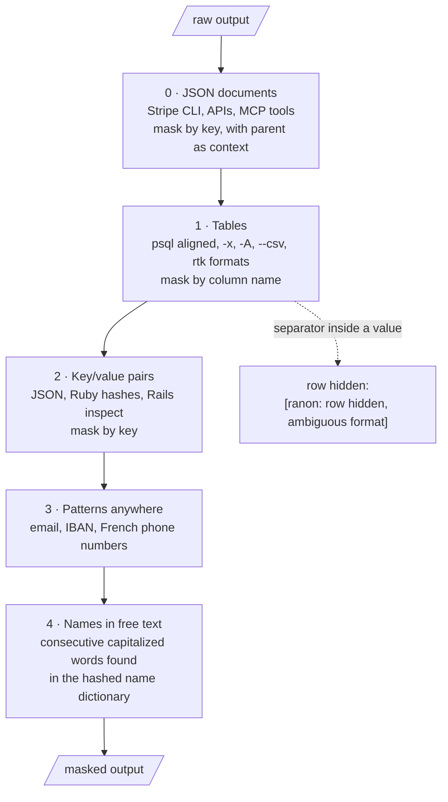
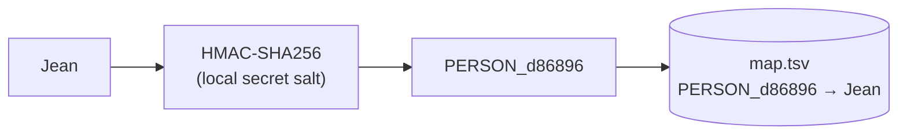

# ranon

[](https://github.com/ludovicl/ranon/actions/workflows/ci.yml)

**Masks personal data in command output before it reaches an LLM agent.**

Coding agents are most useful when they can query real systems: a read replica, a production console, an API. That output often holds names, emails, IBANs or addresses that should not leave your machine. ranon sits between the command and the agent and replaces each sensitive value with a stable pseudonym:

```text
 id |  first_name   |   last_name   |     email     | organisation_name
----+---------------+---------------+---------------+-------------------
 42 | PERSON_d86896 | PERSON_55fc2c | EMAIL_d2f401  | ORG_87d061
```

Same value, same token: the model can still join, count and compare. The token → value map stays on your machine, so you can turn the model's answer back into real values.

Inspired by [rtk](https://github.com/rtk-ai/rtk): one small binary that works as a command proxy, an agent hook or a stdin filter.

## How it works


ranon plugs in at one of three places:

| Mode | How | Covers |
|---|---|---|
| **Agent hook** | `ranon hook claude` as a Claude Code `PostToolUse` hook | Bash output of `psql`, `heroku run`, `stripe` (and any command you add), plus any MCP tool you match |
| **PATH shim** | `ranon init` creates `psql → ranon`; put that directory first in the agent's PATH | Any agent harness, including output redirected to a file |
| **Filter** | `ranon psql …`, `… \| ranon mask` | Manual use and scripts |

### The masking pipeline

Every output goes through five passes, from the most structured to the least:



0. **JSON documents by key path.** When the whole output is JSON, each key is checked alone and as `parent.key`, where the parent is the object's `"object"` field (Stripe, Notion) or the enclosing key. So a Stripe `customer.name` or `billing_details.name` is masked while a product `name` stays readable, and everything under a sensitive key (`address`, `dob`) is masked.
1. **Tables by column name.** Sensitive columns: first/last/full names, email, phone, IBAN, birth date and place, address, nationality, social security or tax number, payer/payee names (creditor, debtor, recipient, customer…), organisation name, IP addresses, passwords and tokens ([`src/rules.rs`](src/rules.rs)). Other columns (`id`, `status`, `amount`, `country`, …) stay readable. A row whose separator count does not match the header is hidden rather than guessed.
2. **Key/value pairs by key**: `first_name: "Jean"`, `"email": "…"`, `"last_name"=>"…"`.
3. **Value patterns anywhere**: email, IBAN, French phone numbers, IPv4 addresses.
4. **Full names in free text**: two or more consecutive capitalized words found in the name dictionary (`Jean Dupont`, `DUPONT Marie-Anne`), or one after a title (`M. Dupont`, `Mme Petit`). A lone dictionary word is left alone, because real databases contain junk "names" such as *Bonjour* or *Paris*.

`psql -t` / `--tuples-only` output is hidden: without a header there is no column name to mask by.

### Tokens



- Tokens are `KIND_` plus the first 6 hex characters of an HMAC with a 32-byte random salt created on first run. Without the salt, a token cannot be reversed or brute-forced from a list of common names.
- Masking is idempotent: a token is never masked twice.
- The name dictionary stores salted 64-bit hashes only, never the names.

## Rules

Built-in rules are grouped by source in [`src/rules/builtin.rs`](src/rules/builtin.rs):

| Set | Covers |
|---|---|
| `common` | names, email, phone, birth date and place, address, nationality, social security and tax numbers, organisation names |
| `payments` | IBAN, creditor/debtor/recipient/cardholder names, card embossed names, Stripe `customer`, `billing_details`, `shipping`, `individual`; command `stripe` |
| `collaboration` | `user.name` in Notion, Slack and GitHub user objects |
| `security` | IP addresses, passwords, API keys and tokens |
| `databases` | commands `psql`, `heroku run` |

### Your own rules

Add yours in `~/.config/ranon/` (or `$XDG_CONFIG_HOME/ranon`, or `$RANON_CONFIG_DIR`), no rebuild needed: `rules.toml`, and any number of `rules.d/*.toml`, e.g. one file per source:

```text
~/.config/ranon/rules.d/
├── notion.toml     # property names of your workspace
├── treezor.toml    # fields of your banking provider
└── gmail.toml      # commands = ["composio"]
```

Each file can hold four kinds of entries:

```toml
# column or key names → kind; user rules are checked before the built-in ones
[[column]]
pattern = '^(nom|prénom)$'
kind = "PERSON"

[[column]]
pattern = '(^|\.)beneficiaries\.name$'      # JSON: "name" inside a "beneficiaries" list
kind = "PERSON"

# values anywhere in the text
[[value]]
pattern = '\b\d{14}\b'
kind = "SIRET"

# keep these visible even if a built-in rule matches
keep = ['^email_id$']

# extra shell commands masked by the Claude Code hook
commands = ["composio"]
```

Patterns are [Rust regexes](https://docs.rs/regex) matched on the lowercased name; kinds are uppercase letters. `ranon rules` lists every source, and tells which rule applies to a name and where it comes from:

```text
$ ranon rules Prénom creditor_name status
user file: ~/.config/ranon/rules.d/notion.toml
  notion.toml: 4 column rules
  built-in payments: 4 column rules, commands: stripe
  …
Prénom: PERSON (notion.toml)
creditor_name: PERSON (built-in payments)
status: kept visible
```

An invalid file is an error, never a silent fallback: the hook then hides the output.

## Install

Requires Rust 1.88+ on Linux or macOS.

```sh
cargo install --git https://github.com/ludovicl/ranon
```

### Name dictionary (optional, for pass 4)

```sh
export DATABASE_URL=postgres://readonly@replica/app
ranon dict build --sql "select first_name from users union select last_name from users"
# or from any source, one or more names per line:
cut -d, -f2,3 people.csv | ranon dict build --stdin
ranon dict stats
```

Names go straight from `psql` into the hasher; they are never printed. `--db-url-env` reads the URL from another variable, `--replace` starts from an empty dictionary.

### Claude Code hook

In `.claude/settings.json`:

```json
{
  "hooks": {
    "PostToolUse": [
      { "matcher": "Bash|mcp__notion__.*|mcp__slack__.*|mcp__metabase__.*",
        "hooks": [{ "type": "command", "command": "ranon hook claude" }] }
    ],
    "PreToolUse": [
      { "matcher": "mcp__notion__notion-(create|update).*",
        "hooks": [{ "type": "command", "command": "ranon hook claude" }] }
    ]
  }
}
```

For Bash, only the outputs of `psql`, `heroku run`, `stripe` and the `commands` of your rules files are masked. For any other matched tool, every string of the response is. If masking fails, the output is replaced by an error message (fail closed).

**Writing back.** When the model writes to a tool (a Notion comment, a page), its text holds tokens. The `PreToolUse` hook puts the real values back, locally, just before the call, and asks you to approve it since the input changed. Unknown tokens are left as they are.

A hook whose binary is missing lets output through, so a `PreToolUse` guard that blocks `psql` when `ranon` is not in `PATH` is a good companion.

### PATH shim (any agent)

```sh
ranon init                 # ~/.local/share/ranon/shims/psql -> ranon
ranon init heroku psql     # several commands
```

Put `~/.local/share/ranon/shims` first in the **agent's** PATH only, not your own shell. The agent keeps typing `psql`; ranon finds the real binary further down the PATH, runs it and masks stdout and stderr, keeping the exit code.

### Manual

```sh
ranon psql "$DATABASE_URL" -c "select …"   # proxy
some-command | ranon mask
pbpaste | ranon unmask                     # restore real values, locally
```

## State

`~/.local/state/ranon/` (override with `RANON_HOME`), directory mode 700, files mode 600:

| File | Content |
|---|---|
| `salt` | 32 random bytes, hex |
| `map.tsv` | token → real value |
| `names.bin` | sorted salted hashes of name words |

**Never share or commit these files.** Anyone with `salt` and `map.tsv` can unmask everything.

## Limits

ranon is a filter, not a security boundary.

- It masks results, not queries: a name you type in a `where` clause is seen by the model.
- Masking depends on names: a field called `name` is only masked where its parent says it is a person. Notion property names are free text, so add yours to the rules file.
- Values outside the known columns, keys and patterns, names missing from the dictionary and lone first names in free text go through.
- Calling the real binary by absolute path bypasses the shim.
- For real isolation, give the agent a database role that can only read pseudonymized views.

## Development

```sh
cargo test                                   # unit + integration tests
cargo clippy --all-targets -- -D warnings
cargo fmt --check
```

Integration tests ([`tests/cli.rs`](tests/cli.rs)) run the real binary against synthetic samples in an isolated `RANON_HOME`.

## License

Licensed under either of [Apache License 2.0](LICENSE-APACHE) or [MIT license](LICENSE-MIT), at your option.
