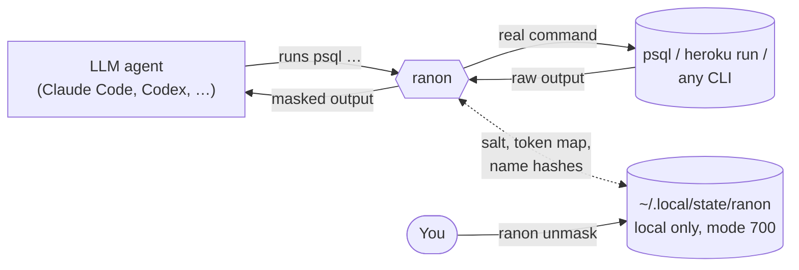
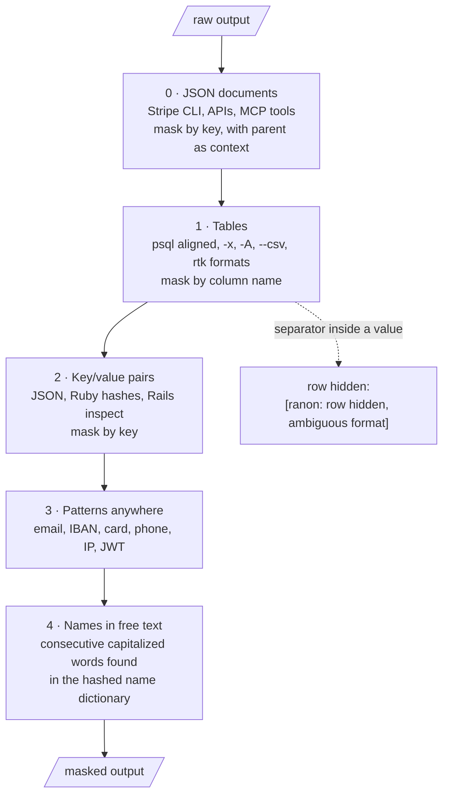
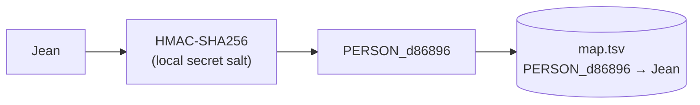

# How it works



ranon plugs in at one of three places:

| Mode | How | Covers |
|---|---|---|
| **Agent hook** | `ranon hook claude` as a Claude Code `PostToolUse` hook | Bash output of `psql`, `heroku run`, `heroku logs`, `stripe` (and any command you add), plus any MCP tool you match |
| **PATH shim** | `ranon init --agent opencode` or `codex` creates `psql → ranon` and puts that directory first in the agent's PATH | Any agent harness, including output redirected to a file |
| **Filter** | `ranon psql …`, `… \| ranon mask` | Manual use and scripts |

## The masking pipeline

Every output goes through five passes, from the most structured to the least:



0. **JSON documents by key path.** Wherever a line starts a JSON document (the whole output, JSON lines, JSON after a banner) or ends by opening one (`#<Treezor::User id=1> JSON: {`), each key is checked alone and as `parent.key`, where the parent is the object's `"object"` field (Stripe, Notion) or the enclosing key. So a Stripe `customer.name` or `billing_details.name` is masked while a product `name` stays readable, and everything under a sensitive key (`address`, `dob`) is masked.
1. **Tables by column name.** Sensitive columns: first/last/full names, email, phone, IBAN, birth date and place, address, nationality, social security or tax number, payer/payee names (creditor, debtor, recipient, customer…), organisation name, IP addresses, passwords and tokens ([`src/rules/builtin.rs`](../src/rules/builtin.rs)). Names are matched as written and in snake_case, so `dateOfBirth` and `Last Name` are covered like `date_of_birth` and `last_name`. Other columns (`id`, `status`, `amount`, `country`, …) stay readable, and so do identifiers, timestamps and flags about a personal field (`address_id`, `phone_verified_at`). A row whose separator count does not match the header is hidden rather than guessed.
2. **Key/value pairs by key**: `first_name: "Jean"`, `"email": "…"`, `"last_name"=>"…"`, JSON inside a CSV cell, and YAML-like lines (`last_name: Dupont`).
3. **Value patterns anywhere**: email (also URL-encoded, `jean%40example.com`), IBAN (known country code and plausible length), card number (Luhn checksum, grouped by four or joined with a card network prefix), French social security number (checked key), French phone numbers, other phone numbers written with their `+` prefix, public IPv4 and IPv6 addresses (private networks, loopback and link-local addresses name no one and stay readable; IPv6 is checked by the standard parser, so clock times and MAC addresses stay readable too), and JWTs, masked whole as `SECRET` since their payload carries the user's email.
4. **Full names in free text**: two or more consecutive capitalized words found in the name dictionary (`Jean Dupont`, `DUPONT Marie-Anne`), or one after a title (`M. Dupont`, `Mme Petit`). Words split only by a record separator count as consecutive: a pipe, a tab or the items of a quoted array (`Jean | Dupont`, `["Jean", "Dupont"]`), but not a plain comma, which in prose separates different people. A lone dictionary word is left alone, because real databases contain junk "names" such as *Bonjour* or *Paris*.

`psql -t` / `--tuples-only` output is hidden: without a header there is no column name to mask by.

Postgres constraint errors are read like a one-row table: in `Key (last_name, first_name)=(Dupont, Paul) already exists.` each value is masked by its column. `Failing row contains (…)` quotes a whole row without column names, so it is hidden.

## How names are recognized

A name is masked in one of two ways, depending on where it shows up.

**In a named field** (a column, a JSON key, a key/value pair), ranon looks at the name of the field, never at the value. `first_name`, `lastName`, `Nom` or `real_name` match a `PERSON` rule, so the whole value is replaced, whatever it is. A lone first name or a surname nobody has seen before is masked like any other.

**In free text** (a chat message, a ticket body, a comment) there is no field name, so ranon uses a dictionary built from your own data:

1. `ranon dict build` reads the first and last names of your users table. Each word is lowercased, stripped of its accents and hashed with the local salt; only the hash is written to `names.bin`. The names are never printed, so the agent that runs the command does not see them. ranon also adds the words of every name it masks in a column (a Slack author in `RealName`, a `first_name`, a Stripe customer's `name`), even without `dict build`: a colleague who wrote a message is then masked where another message quotes their full name, in the same output or a later one.
2. For each capitalized word of the text, ranon computes the same hash and looks it up.
3. A word found in the dictionary is masked only next to another dictionary word (`Jean Dupont`, `DUPONT Marie-Anne`) or after a title (`M. Dupont`), including across a record separator (`Jean | Dupont`).

The dictionary does not try to know every surname in the world, only the names of the people whose data can come out of your systems. The list is as long as your users table, and a rare surname is in it as soon as one user bears it.

What follows from this design:

- Someone outside the source table (a colleague, a contact at a supplier) is not recognized in free text until ranon has masked their name in a column, unless a user shares the name.
- A lone first name or surname, and a name written in lowercase, stay readable in free text.
- The dictionary is a snapshot. A user created after the last `ranon dict build` with a name nobody else has is missing until you rebuild it; schedule the command (weekly is enough) if your data moves.
- In free text every word gets its own token (`PERSON_aaaaaa PERSON_bbbbbb`), while a `full_name` column gets one token for the whole value: the same person can bear both.
- `names.bin` cannot be read back into names. With the salt, though, one can test whether a given name is in it: one more reason never to share the state directory.

## Tokens



- Tokens are `KIND_` plus the first 6 hex characters of an HMAC with a 32-byte random salt created on first run. Without the salt, a token cannot be reversed or brute-forced from a list of common names.
- Two values that would fall on the same token get different ones: the second is rehashed, so unmasking never returns someone else's value.
- Spellings of the same email (case) or IBAN (spaces) share one token.
- Masking is idempotent: a token is never masked twice.
- The name dictionary stores salted 64-bit hashes only, never the names.

## State

`~/.local/state/ranon/` (override with `RANON_HOME`), directory mode 700, files mode 600:

| File | Content |
|---|---|
| `salt` | 32 random bytes, hex |
| `map.tsv` | token → real value, with the time it was first masked |
| `names.bin` | sorted salted hashes of name words |
| `hook.log` | one line per output the hook masked, hid or could not mask after a crash: time, tool, outcome, number of values, and for a crash the place in ranon's code (`src/mask.rs:52`). No content |

**Never share or commit these files.** Anyone with `salt` and `map.tsv` can unmask everything.

`map.tsv` holds real personal data in clear, so do not keep it longer than you need to unmask answers:

```sh
ranon forget --older-than 30   # drop values first masked more than 30 days ago
ranon forget                   # drop everything
```

A forgotten value keeps the same token the next time it shows up; only old answers can no longer be unmasked.
